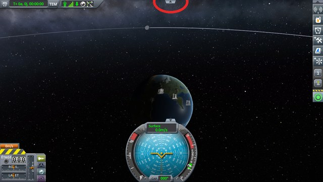
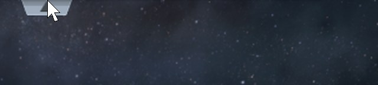
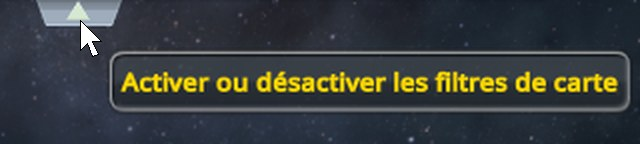
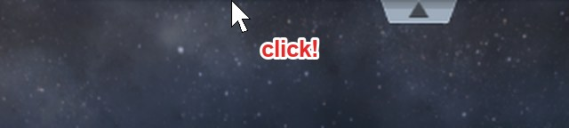
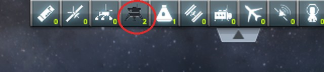

# Map Filter Fix

**⚠️ Not finished yet.** This is a new fix, not a finished mod. The code and the conclusions on this page can still change.

A fix for stock KSP 1.12, kept as small as possible: one Harmony patch, in one short source file. It is a
mod of its own, built on top of
[KSP Community Fixes](https://github.com/KSPModdingLibs/KSPCommunityFixes), the base most players run.
Here is what it fixes:

> **In the map view, a click at the very top of the screen, on the tab that opens the vessel filters,
> does not open them: it toggles one of the filters instead, without showing anything.** The tab only
> opens when aimed at a few pixels lower.

**How this was made.** The investigation and the code were written with Claude, Anthropic's AI
assistant. Everything here was reviewed and validated by a human — me. I am saying so up front, because
contributions made with an AI deserve a closer look than others, and because some people would rather
stop reading here. That look should be quick: the stock code involved is named on this page, every check
below is read on screenshots of the game, taken by a public script that plays its protocol, and the fix is
one short file you can read in a few minutes.

## Why a click at the top of the screen matters

In the map view, the small tab with an arrow, at the top of the screen in the middle, opens a row of
buttons that choose which types of vessels the map shows: probes, stations, debris, and so on. The tab
touches the top edge of the screen, so the natural gesture is to throw the mouse up against the edge and
click.



On stock, the mouse on the top row of pixels does not reach the tab: the tab does not light up, and its
tooltip does not show. Ten pixels lower, both do.





So a click on the top row does not open the row of filters. Worse, it toggles the filter whose hidden
button sits above the cursor, along the whole width of the row. Nothing on screen says so; those vessels
leave the map, and the player only finds out later, from the unchecked button, the next time the row is
open. Below, a click on the top row, left of the tab, then the row opened: the landers filter is off.





*KSP 1.12.5 without this mod, with [KSP Community Fixes](https://github.com/KSPModdingLibs/KSPCommunityFixes),
in French, in a 1280 × 720 window, in the map view of a flight on the launch pad. Screenshots do not show
the mouse cursor: it is drawn where it was. The four close-ups are cropped from the top of the screen and
zoomed twice. First, the mouse rests on the top row of pixels over the tab, then ten pixels lower, a
couple of seconds each. Then it is moved to the top row, 106 pixels left of the tab's centre, and clicked;
the row of filters is opened afterwards, the mouse away from it.*

## The culprit: the folded row keeps its buttons just above the screen

The row is a panel driven by `MapViewFiltering`, which slides between two positions with a
`UIPanelTransitionToggle`. Folded, the panel sits just above the screen, and its filter buttons
(`TrackingStationObjectButton`) stay where they are in it. The panel does not go quite far enough: the
lower edge of those buttons still reaches a few pixels into the screen. That edge is transparent, so
nothing shows, but a button takes clicks on its whole rectangle.

The tab is a sibling of those buttons, placed before them, so they are drawn over it and the user
interface hands them the click first. Over the tab and on either side of it, along the whole width of
the row, the top few pixels of the screen belong to filter buttons nobody can see.

## The fix: hidden buttons ignore clicks

One patch, with its own switch in [Settings](#settings), on by default. Nothing is saved; removing the
mod gives the stock behaviour back at once.

- **`foldedFiltersIgnoreClicks`.** After `MapViewFiltering.Start`, the mod gives each filter button a
  `CanvasGroup`, and turns off its `blocksRaycasts` while the panel rests folded. As soon as the panel
  moves, either way, the buttons take clicks again, as on stock. The tab itself is left alone: its
  clickable area already reaches the top edge of the screen. The tracking station's filters, which have
  no tab and never fold, are left alone too.
- **How "folded" is told.** The panel's two positions are named `Out` for the folded one and `In` for the
  open one, so `UIPanelTransitionToggle.expanded` is true while the panel is folded. The mod does not use
  it: the folded position is the higher of the two, the one that hides the panel above the screen.
- **Why not move the panel further up.** It would change where the panel sits and how it slides, which
  other mods may rely on: KSP Community Fixes' `AltimeterHorizontalPosition` hides and shows this panel
  around the map view. Turning off the clicks of hidden buttons changes nothing that can be seen.

## Checked: the map view

In the map view of a flight, the tab is clicked on the top row of pixels, then a filter of the open row is
clicked and another right-clicked. On stock, the row stays folded and the planes filter goes off; with this
mod, the row opens, no filter changes, and the filters respond as on stock.

**→ Full chapter: [Checking the map view](docs/checking-map-view.md)**

## Checked: the tracking station

The tracking station shows the same filters, in its top bar, with no tab. A filter is clicked and another
right-clicked. On stock as with this mod, both respond: the mod leaves these filters alone, and its log
says so.

**→ Full chapter: [Checking the tracking station](docs/checking-tracking-station.md)**

## Checked: KSP Community Fixes with the altimeter moved

With KSPCF's altimeter moved, the tab is clicked on the top row of pixels before and after leaving the map
view and coming back. On stock, the row stays folded both times, and each click toggles the planes filter;
with this mod, it opens both times, and no filter changes.

**→ Full chapter: [Checking KSP Community Fixes with the altimeter moved](docs/checking-altimeter-moved.md)**

## Checked: other screen sizes and interface scales

The map view protocol is played again at 1920 × 1080, interface at 100 % and 150 %, and at 1280 × 720,
at 80 %. Each time, the click on the top row turns the planes filter off on stock, and opens the
row with this mod.

**→ Full chapter: [Checking other screen sizes and interface scales](docs/checking-screen-sizes.md)**

## Install

Copy the `GameData\KSPFixMapFilter` folder into the `GameData` folder of KSP. It needs
[Harmony](https://github.com/KSPModdingLibs/HarmonyKSP), as KSP Community Fixes does.

## Settings

`GameData\KSPFixMapFilter\PluginData\settings.cfg` is read once, when KSP starts:

```
// Keeps the filter buttons of the map view's vessel filter panel from taking clicks while the panel is
// folded.
foldedFiltersIgnoreClicks = True

// How much the mod writes to KSP.log: Error, Warning, Info or Debug.
logLevel = Info
```

- With `foldedFiltersIgnoreClicks = False`, the filter buttons take clicks as on stock.
- At `Debug`, the mod writes one line to `KSP.log` every time the filter buttons start or stop ignoring
  clicks, and one when it finds filters that do not fold, as in the tracking station.

## Build

Set `KSPDIR` to the folder of a KSP install with Harmony in its `GameData`, then run `build.bat`: it
compiles `GameData\KSPFixMapFilter\KSPFixMapFilter.dll`. Installing is up to you.

## License

[MIT](LICENSE).
