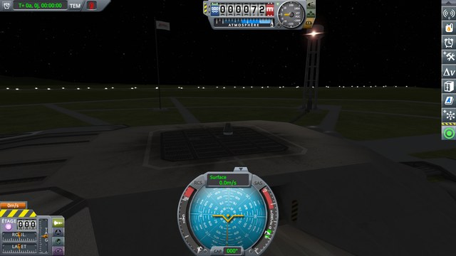
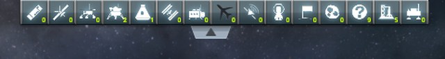
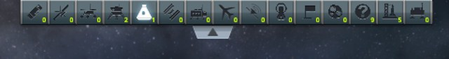
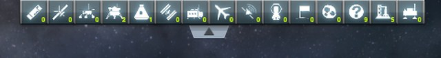
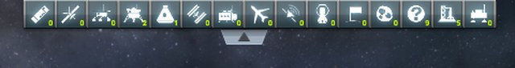
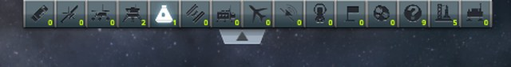

# Checking KSP Community Fixes with the altimeter moved

Part of [Map Filter Fix](../README.md). When the altimeter is not at its stock place, KSP Community Fixes'
`AltimeterHorizontalPosition` hides the panel of the vessel filters outside the map view, and shows it
again in the map view. In the map view, the tab of the filters is clicked on the top row of pixels, before
and after leaving the map view and coming back. Does the tab open the row, and do the filters still
respond? Played without this mod, then with it.

## The install

The same as for [the map view](checking-map-view.md#the-install), but with the altimeter moved:
`altimeterPosition = 0.3` in `GameData\KSPCommunityFixes\PluginData\AltimeterHorizontalPosition.cfg`, set
by hand before KSP starts. The altimeter then sits right of the middle of the screen:

## The protocol

The save of [the map view](checking-map-view.md#the-protocol), [map-filter-kerbin.sfs](../diag/map-filter-kerbin.sfs):
a small capsule on the launch pad of a sandbox game, every vessel filter on. Copy it into the folder of a
sandbox game, and load it.

1. Press M to enter the map view, and click the top row of pixels of the screen, over the middle of the
   tab.
2. If the row is still folded, click the tab lower down, below the hidden filter buttons.
3. Press M to leave the map view, and M again to come back.
4. Click the top row of pixels, over the middle of the tab.
5. If the row is still folded, click the tab lower down.
6. Click the second filter of the row, *Probes*, then right-click the fifth, *Ships*: that shows ships
   alone.

**Played by a script.** [run-filters.py](../diag/automation/run-filters.py), with
`--protocol altimeter-moved`. It enters and leaves the map view as the M key does, and finds the points it
clicks as for [the map view](checking-map-view.md#the-protocol). It takes a screenshot at the start, in the
flight view (the image above), then after each step, after both clicks at step 6.

A screenshot follows each step. The images below are cropped as for
[the map view](checking-map-view.md#the-protocol). An unchecked filter has a black icon.

## On stock

Read off the screenshots below:

| Step | The row | Filters off |
|---|---|---|
| 1. Click on the top row | **folded** | — |
| 2. Click lower down | open | **Planes** |
| 3. M, M | folded | — |
| 4. Click on the top row | **folded** | — |
| 5. Click lower down | open | **none** |
| 6. *Probes*, then right-click on *Ships* | open | every one but Ships |

As with the altimeter at its place, the click on the top row leaves the row folded and turns the planes
filter off; the second one, after coming back to the map view, turns it on again. Coming back to the map
view folds the row.

     

The six screenshots, on stock

After the click on the top row:

After the click lower down:

Back in the map view:

After the second click on the top row:

After the second click lower down:

After Probes and Ships:

## With this mod

Read off the screenshots below:

| Step | The row | Filters off |
|---|---|---|
| 1. Click on the top row | **open** | **none** |
| 2. (the row is open: no click) | open | none |
| 3. M, M | folded | — |
| 4. Click on the top row | **open** | **none** |
| 5. (the row is open: no click) | open | none |
| 6. *Probes*, then right-click on *Ships* | open | every one but Ships |

Both clicks on the top row open the row, before and after coming back to the map view, and no filter
changes. The filters of the open row respond as on stock.

     

The six screenshots, with this mod

After the click on the top row:

At step 2, no click:

Back in the map view:

After the second click on the top row:

At step 5, no click:

After Probes and Ships:

