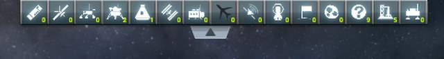
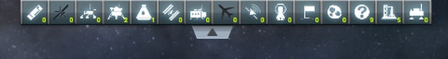
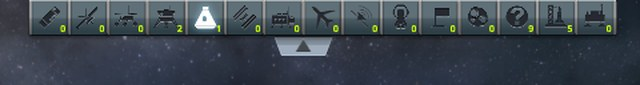
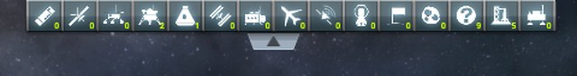
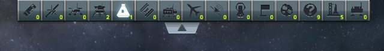

# Checking the map view

Part of [Map Filter Fix](../README.md). In the map view of a flight, the tab of the vessel filters is
clicked on the top row of pixels of the screen, then the filters of the open row are clicked. Does the
tab open the row, and do the filters still respond? Played without this mod, then with it.

## The install

KSP 1.12.5 with KSP Community Fixes 1.41.1, in French, in a 1280 × 720 window, with Map Filter Fix 0.1.0
at `Debug` for *With this mod*. KSPCF's altimeter is at its stock place.

[KSP-Util-MCPServer](https://github.com/lhervier/KSP-Util-MCPServer) is installed in both: it took the
screenshots, and it set every filter back on between the runs. The clicks are real mouse clicks, sent to
Windows by a script at fixed points of the window; nothing else moved the mouse.

## The protocol

Any vessel in flight will do; here, a small capsule on the launch pad of a sandbox game. Every filter is on
at the start, and the row of filters is folded.

1. Enter the map view (here, through KSP-Util-MCPServer, before the first screenshot).
2. Click the top row of pixels of the screen, over the middle of the tab.
3. If the row is still folded, click the tab ten pixels lower.
4. Click the second filter of the row, *Probes*.
5. Right-click the fifth, *Ships*: that shows ships alone.
6. Click the tab, under the open row, to fold it.

A screenshot follows each of steps 2 to 6. The images below are the top of the screen, between 448 and
928 pixels from the left and 64 pixels high, at 640 pixels wide. An unchecked filter has a black icon.

## On stock

Read off the screenshots below:

| Step | The row | Filters off |
|---|---|---|
| 2. Click on the top row | **folded** | — |
| 3. Click ten pixels lower | open | **Planes** |
| 4. Click on *Probes* | open | Probes, Planes |
| 5. Right-click on *Ships* | open | every one but Ships |
| 6. Click on the tab | folded | — |

The click on the top row leaves the row folded, and turns the planes filter off: its hidden button, not
the tab, took it. The filters of the open row respond to both buttons of the mouse.

<p class="thumbs"><a href="../imgs/checking-map-view/stock/1-click-top-edge.jpg"></a> <a href="../imgs/checking-map-view/stock/2-row-open.jpg"></a> <a href="../imgs/checking-map-view/stock/3-probes-clicked.jpg"></a> <a href="../imgs/checking-map-view/stock/4-ships-right-clicked.jpg"></a> <a href="../imgs/checking-map-view/stock/5-row-folded.jpg"></a></p>

<details>
<summary>The five screenshots, on stock</summary>

After the click on the top row:


After the click ten pixels lower:


After the click on Probes:


After the right-click on Ships:


After the click on the tab:


</details>

## With this mod

Read off the screenshots below:

| Step | The row | Filters off |
|---|---|---|
| 2. Click on the top row | **open** | **none** |
| 3. (the row is open: no click) | open | none |
| 4. Click on *Probes* | open | Probes |
| 5. Right-click on *Ships* | open | every one but Ships |
| 6. Click on the tab | folded | — |

The click on the top row opens the row, and no filter changes. The filters of the open row respond to
both buttons of the mouse, as on stock, and the tab folds the row. The mod's log follows the row, one line
each time it settles folded or starts to move:

```
[KSPFixMapFilter] [DEBUG] Vessel filter panel folded, its filter buttons ignore clicks
[KSPFixMapFilter] [DEBUG] Vessel filter panel moving or open, its filter buttons take clicks
```

<p class="thumbs"><a href="../imgs/checking-map-view/fix/1-click-top-edge.jpg"></a> <a href="../imgs/checking-map-view/fix/2-row-open.jpg"></a> <a href="../imgs/checking-map-view/fix/3-probes-clicked.jpg"></a> <a href="../imgs/checking-map-view/fix/4-ships-right-clicked.jpg"></a> <a href="../imgs/checking-map-view/fix/5-row-folded.jpg"></a></p>

<details>
<summary>The five screenshots, with this mod</summary>

After the click on the top row:


At step 3, no click:


After the click on Probes:


After the right-click on Ships:


After the click on the tab:


</details>
