# Checking other screen sizes and interface scales

Part of [Map Filter Fix](../README.md). The [map view protocol](checking-map-view.md#the-protocol) is
played again at other screen sizes and interface scales: the tab of the vessel filters is clicked on the
top row of pixels of the screen, then the filters of the open row are clicked. Does the tab open the row,
and do the filters still respond? Played without this mod, then with it, in each configuration.

## The install

KSP 1.12.5 with KSP Community Fixes 1.41.1, in French, with Map Filter Fix 0.1.0 at `Debug` for *With this
mod*. KSPCF's altimeter is at its stock place. Three configurations, each set in KSP's `settings.cfg`
before starting the game (`SCREEN_RESOLUTION_WIDTH`, `SCREEN_RESOLUTION_HEIGHT`, and `UI_SCALE`, the
interface scale of the game's settings):

- **1920 × 1080, interface at 100 %**, in a borderless window the size of the screen (KSP started with
  `-popupwindow`);
- **1920 × 1080, interface at 150 %**, the same window;
- **1280 × 720, interface at 80 %**, the lowest the game's settings offer, in a window.

[KSP-Util-MCPServer](https://github.com/lhervier/KSP-Util-MCPServer) is installed in both runs, to play the
protocol by script.

## The protocol

The save of the map view protocol, [map-filter-kerbin.sfs](../diag/map-filter-kerbin.sfs): a small capsule
on the launch pad of a sandbox game, every vessel filter on. The row of filters is folded. The steps are
those of the map view protocol:

1. Enter the map view.
2. Click the top row of pixels of the screen, over the middle of the tab.
3. If the row is still folded, click the tab lower down, below the hidden filter buttons.
4. Click the second filter of the row, *Probes*.
5. Right-click the fifth, *Ships*: that shows ships alone.
6. Click the tab, under the open row, to fold it.

**Played by a script.** [run-filters.py](../diag/automation/run-filters.py), with `--protocol map-view`,
in each configuration, as for [the map view](checking-map-view.md#the-protocol). The interface scale
changes the size of the row and of the tab, and the script finds the points it clicks in each
configuration by moving the pointer over the screen first. They came out, in pixels from the left and from
the top of the window:

| | 1920 × 1080, 100 % | 1920 × 1080, 150 % | 1280 × 720, 80 % |
|---|---|---|---|
| Middle of the tab (steps 2, 3 and 6) | 996 | 1013 | 668 |
| Step 2, the top row | 0 | 0 | 0 |
| Step 3, the tab lower down | 6 | 10 | 5 |
| Steps 4 and 5, *Probes* and *Ships* | 834 and 922, at 15 | 771 and 903, at 23 | 539 and 610, at 12 |
| Step 6, the tab under the open row | 35 | 54 | 28 |

A screenshot follows each of steps 2 to 6. The images below are the top of the screen, around the row of
filters, at 640 pixels wide: the same part of the interface in each configuration, so the frame grows
with the interface scale (between 768 and 1248 pixels from the left and 64 high at 1920 × 1080, 100 %;
671 to 1391 and 96 high at 150 %; 486 to 870 and 51 high at 1280 × 720, 80 %). An unchecked filter has a
black icon.

## 1920 × 1080, interface at 100 %

### On stock

Read off the screenshots below:

| Step | The row | Filters off |
|---|---|---|
| 2. Click on the top row | **folded** | — |
| 3. Click lower down | open | **Planes** |
| 4. Click on *Probes* | open | Probes, Planes |
| 5. Right-click on *Ships* | open | every one but Ships |
| 6. Click on the tab | folded | — |

As in the map view protocol, the click on the top row leaves the row folded, and turns the planes filter
off: its hidden button, not the tab, took it. The filters of the open row respond to both buttons of the
mouse.

<p class="thumbs"><a href="../imgs/checking-screen-sizes/1920x1080-100/stock/1-click-top-edge.jpg"></a> <a href="../imgs/checking-screen-sizes/1920x1080-100/stock/2-row-open.jpg">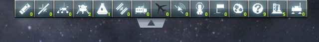</a> <a href="../imgs/checking-screen-sizes/1920x1080-100/stock/3-probes-clicked.jpg">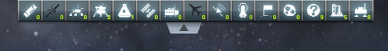</a> <a href="../imgs/checking-screen-sizes/1920x1080-100/stock/4-ships-right-clicked.jpg">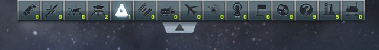</a> <a href="../imgs/checking-screen-sizes/1920x1080-100/stock/5-row-folded.jpg"></a></p>

<details>
<summary>The five screenshots, on stock, at 1920 × 1080, 100 %</summary>

After the click on the top row:


After the click lower down:


After the click on Probes:


After the right-click on Ships:


After the click on the tab:


</details>

### With this mod

Read off the screenshots below:

| Step | The row | Filters off |
|---|---|---|
| 2. Click on the top row | **open** | **none** |
| 3. (the row is open: no click) | open | none |
| 4. Click on *Probes* | open | Probes |
| 5. Right-click on *Ships* | open | every one but Ships |
| 6. Click on the tab | folded | — |

The click on the top row opens the row, and no filter changes. The filters of the open row respond to both
buttons of the mouse, as on stock, and the tab folds the row. The mod's log follows the row, one line each
time it settles folded or starts to move:

```
[KSPFixMapFilter] [DEBUG] Vessel filter panel folded, its filter buttons ignore clicks
[KSPFixMapFilter] [DEBUG] Vessel filter panel moving or open, its filter buttons take clicks
```

<p class="thumbs"><a href="../imgs/checking-screen-sizes/1920x1080-100/fix/1-click-top-edge.jpg">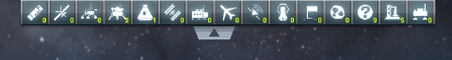</a> <a href="../imgs/checking-screen-sizes/1920x1080-100/fix/2-row-open.jpg">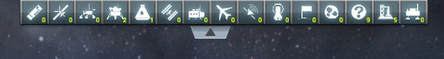</a> <a href="../imgs/checking-screen-sizes/1920x1080-100/fix/3-probes-clicked.jpg">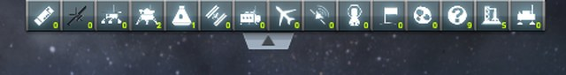</a> <a href="../imgs/checking-screen-sizes/1920x1080-100/fix/4-ships-right-clicked.jpg"></a> <a href="../imgs/checking-screen-sizes/1920x1080-100/fix/5-row-folded.jpg"></a></p>

<details>
<summary>The five screenshots, with this mod, at 1920 × 1080, 100 %</summary>

After the click on the top row:


At step 3, no click:


After the click on Probes:


After the right-click on Ships:


After the click on the tab:


</details>

## 1920 × 1080, interface at 150 %

### On stock

Read off the screenshots below:

| Step | The row | Filters off |
|---|---|---|
| 2. Click on the top row | **folded** | — |
| 3. Click lower down | open | **Planes** |
| 4. Click on *Probes* | open | Probes, Planes |
| 5. Right-click on *Ships* | open | every one but Ships |
| 6. Click on the tab | folded | — |

As in the map view protocol, the click on the top row leaves the row folded, and turns the planes filter
off: its hidden button, not the tab, took it. The filters of the open row respond to both buttons of the
mouse.

<p class="thumbs"><a href="../imgs/checking-screen-sizes/1920x1080-150/stock/1-click-top-edge.jpg"></a> <a href="../imgs/checking-screen-sizes/1920x1080-150/stock/2-row-open.jpg">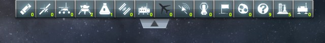</a> <a href="../imgs/checking-screen-sizes/1920x1080-150/stock/3-probes-clicked.jpg">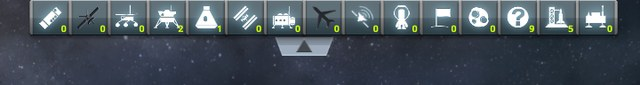</a> <a href="../imgs/checking-screen-sizes/1920x1080-150/stock/4-ships-right-clicked.jpg">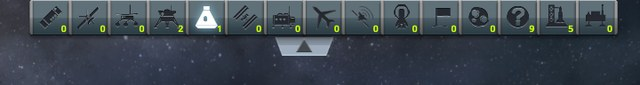</a> <a href="../imgs/checking-screen-sizes/1920x1080-150/stock/5-row-folded.jpg"></a></p>

<details>
<summary>The five screenshots, on stock, at 1920 × 1080, 150 %</summary>

After the click on the top row:


After the click lower down:


After the click on Probes:


After the right-click on Ships:


After the click on the tab:


</details>

### With this mod

Read off the screenshots below:

| Step | The row | Filters off |
|---|---|---|
| 2. Click on the top row | **open** | **none** |
| 3. (the row is open: no click) | open | none |
| 4. Click on *Probes* | open | Probes |
| 5. Right-click on *Ships* | open | every one but Ships |
| 6. Click on the tab | folded | — |

The click on the top row opens the row, and no filter changes. The filters of the open row respond to both
buttons of the mouse, as on stock, and the tab folds the row. The mod's log follows the row, one line each
time it settles folded or starts to move:

```
[KSPFixMapFilter] [DEBUG] Vessel filter panel folded, its filter buttons ignore clicks
[KSPFixMapFilter] [DEBUG] Vessel filter panel moving or open, its filter buttons take clicks
```

<p class="thumbs"><a href="../imgs/checking-screen-sizes/1920x1080-150/fix/1-click-top-edge.jpg">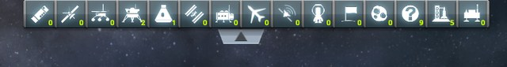</a> <a href="../imgs/checking-screen-sizes/1920x1080-150/fix/2-row-open.jpg">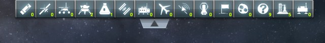</a> <a href="../imgs/checking-screen-sizes/1920x1080-150/fix/3-probes-clicked.jpg">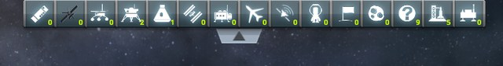</a> <a href="../imgs/checking-screen-sizes/1920x1080-150/fix/4-ships-right-clicked.jpg">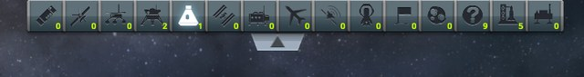</a> <a href="../imgs/checking-screen-sizes/1920x1080-150/fix/5-row-folded.jpg"></a></p>

<details>
<summary>The five screenshots, with this mod, at 1920 × 1080, 150 %</summary>

After the click on the top row:


At step 3, no click:


After the click on Probes:


After the right-click on Ships:


After the click on the tab:


</details>

## 1280 × 720, interface at 80 %

### On stock

Read off the screenshots below:

| Step | The row | Filters off |
|---|---|---|
| 2. Click on the top row | **folded** | — |
| 3. Click lower down | open | **Planes** |
| 4. Click on *Probes* | open | Probes, Planes |
| 5. Right-click on *Ships* | open | every one but Ships |
| 6. Click on the tab | folded | — |

As in the map view protocol, the click on the top row leaves the row folded, and turns the planes filter
off: its hidden button, not the tab, took it. The filters of the open row respond to both buttons of the
mouse.

<p class="thumbs"><a href="../imgs/checking-screen-sizes/1280x720-80/stock/1-click-top-edge.jpg"></a> <a href="../imgs/checking-screen-sizes/1280x720-80/stock/2-row-open.jpg">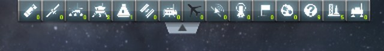</a> <a href="../imgs/checking-screen-sizes/1280x720-80/stock/3-probes-clicked.jpg">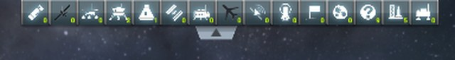</a> <a href="../imgs/checking-screen-sizes/1280x720-80/stock/4-ships-right-clicked.jpg">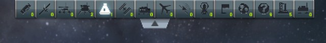</a> <a href="../imgs/checking-screen-sizes/1280x720-80/stock/5-row-folded.jpg"></a></p>

<details>
<summary>The five screenshots, on stock, at 1280 × 720, 80 %</summary>

After the click on the top row:


After the click lower down:


After the click on Probes:


After the right-click on Ships:


After the click on the tab:


</details>

### With this mod

Read off the screenshots below:

| Step | The row | Filters off |
|---|---|---|
| 2. Click on the top row | **open** | **none** |
| 3. (the row is open: no click) | open | none |
| 4. Click on *Probes* | open | Probes |
| 5. Right-click on *Ships* | open | every one but Ships |
| 6. Click on the tab | folded | — |

The click on the top row opens the row, and no filter changes. The filters of the open row respond to both
buttons of the mouse, as on stock, and the tab folds the row. The mod's log follows the row, one line each
time it settles folded or starts to move:

```
[KSPFixMapFilter] [DEBUG] Vessel filter panel folded, its filter buttons ignore clicks
[KSPFixMapFilter] [DEBUG] Vessel filter panel moving or open, its filter buttons take clicks
```

<p class="thumbs"><a href="../imgs/checking-screen-sizes/1280x720-80/fix/1-click-top-edge.jpg">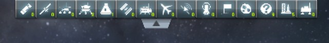</a> <a href="../imgs/checking-screen-sizes/1280x720-80/fix/2-row-open.jpg"></a> <a href="../imgs/checking-screen-sizes/1280x720-80/fix/3-probes-clicked.jpg"></a> <a href="../imgs/checking-screen-sizes/1280x720-80/fix/4-ships-right-clicked.jpg"></a> <a href="../imgs/checking-screen-sizes/1280x720-80/fix/5-row-folded.jpg"></a></p>

<details>
<summary>The five screenshots, with this mod, at 1280 × 720, 80 %</summary>

After the click on the top row:


At step 3, no click:


After the click on Probes:


After the right-click on Ships:


After the click on the tab:


</details>
