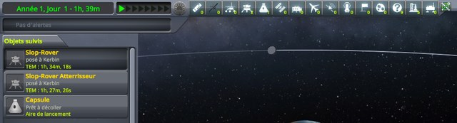
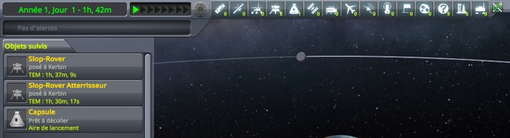
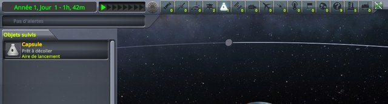

# Checking the tracking station

Part of [Map Filter Fix](../README.md). The tracking station shows the same vessel filters, in its top bar.
Its filters are clicked with both buttons of the mouse. Do they still respond? Played without this mod,
then with it.

## The install

The same as for [the map view](checking-map-view.md#the-install).

## The protocol

A sandbox game with a few vessels: two landed on Kerbin, and a small capsule on the launch pad. Every
filter is on at the start.

1. Open the tracking station from the space centre. On a first visit, it shows a welcome message: close it.
2. Click the second filter of the top bar, *Probes*.
3. Right-click the fifth, *Ships*: that shows ships alone.

A screenshot follows each step. The images below are the top left of the screen, 960 by 260 pixels, at 640
pixels wide: the list of tracked objects, and the filters. An unchecked filter has a black icon.

## On stock

Read off the screenshots below:

| Step | Filters off | Tracked objects listed |
|---|---|---|
| 1. The tracking station | none | Slop-Rover, Slop-Rover Atterrisseur, Capsule |
| 2. Click on *Probes* | Probes | Slop-Rover, Slop-Rover Atterrisseur, Capsule |
| 3. Right-click on *Ships* | every one but Ships | Capsule |

The row of filters has no tab here and never folds.

<p class="thumbs"><a href="../imgs/checking-tracking-station/stock/1-tracking-station.jpg"></a> <a href="../imgs/checking-tracking-station/stock/2-probes-clicked.jpg"></a> <a href="../imgs/checking-tracking-station/stock/3-ships-right-clicked.jpg"></a></p>

<details>
<summary>The three screenshots, on stock</summary>

The tracking station:


After the click on Probes:


After the right-click on Ships:


</details>

## With this mod

Read off the screenshots below, the same as on stock:

| Step | Filters off | Tracked objects listed |
|---|---|---|
| 1. The tracking station | none | Slop-Rover, Slop-Rover Atterrisseur, Capsule |
| 2. Click on *Probes* | Probes | Slop-Rover, Slop-Rover Atterrisseur, Capsule |
| 3. Right-click on *Ships* | every one but Ships | Capsule |

The mod leaves these filters alone, since they do not fold. Its log says so when the tracking station
opens:

```
[KSPFixMapFilter] [DEBUG] These vessel filters do not fold, nothing to fix
```

<p class="thumbs"><a href="../imgs/checking-tracking-station/fix/1-tracking-station.jpg"></a> <a href="../imgs/checking-tracking-station/fix/2-probes-clicked.jpg"></a> <a href="../imgs/checking-tracking-station/fix/3-ships-right-clicked.jpg"></a></p>

<details>
<summary>The three screenshots, with this mod</summary>

The tracking station:


After the click on Probes:


After the right-click on Ships:


</details>
